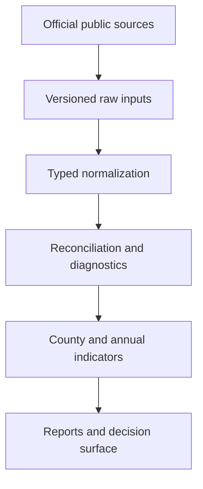

# Architecture

RecoveryLens is a reproducible Python data pipeline rather than a one-off analytical notebook. Source acquisition, normalization, validation, aggregation, and publication readiness are separate concerns.

## Layer responsibilities

| Layer | Responsibility | Current implementation |
|---|---|---|
| Source acquisition | Bounded requests, pagination, retries, revision selection, and retrieval metadata | `fema.py`, `noaa.py` |
| Normalization | Types, identifiers, dates, magnitude suffixes, and explicit parse states | `fema.py`, `storm_damage.py`, `storm_impacts.py` |
| Reconciliation | Duplicate diagnostics, raw-to-curated totals, linkage, and mismatch evidence | `reconciliation.py`, `storm_impacts.py` |
| Quality gates | Coverage thresholds, validation severity, and machine/human reports | `coverage.py`, `quality.py` |
| Measures | Transparent scores, obligation categories, timing, damage, injuries, and deaths | `metrics.py`, `obligations.py`, `storm_damage.py`, `storm_impacts.py` |
| Interface | Reproducible command-line entry points | `cli.py` |

## Data flow

### FEMA

1. Query OpenFEMA with typed, bounded filters.
2. Normalize declarations or funded project records.
3. Preserve invalid and unmatched geography states.
4. Reconcile source and curated funding totals.
5. Measure county-attribution coverage.
6. Produce category, timing, and run-level quality outputs.

### NOAA

1. Discover the live Storm Events bulk-file catalog.
2. Select the newest creation date within the requested schema version, or the highest available schema followed by its newest revision.
3. Download atomically and verify GZIP integrity, byte size, and SHA-256 checksum.
4. Parse damage or casualty fields without turning missing values into zero.
5. Exclude ambiguous event identifiers from aggregates while retaining diagnostics.
6. Reconcile person-level fatality rows to event-level death counts without adding them together.

## Trust boundaries

- Upstream agency data may be revised after retrieval.
- A checksum proves file identity, not substantive correctness.
- Internal reconciliation validates the transformation, not equivalence to an agency's official financial system.
- A `warning` output remains available for review; a `failed` output must not be published analytically.
- Generated raw and processed data remain outside Git because they must be reproducible from official sources.

## Design rules

- Deterministic outputs for the same inputs and run metadata
- Explicit missingness and exclusions
- Stable, documented join keys
- Bounded network requests by default
- Tests around malformed, missing, duplicate, and conflicting records
- Method changes reviewed alongside code changes

See [[Data Quality and Review|Data-Quality-and-Review]] for the publication gates and [[Reproducibility]] for a runnable workflow.
